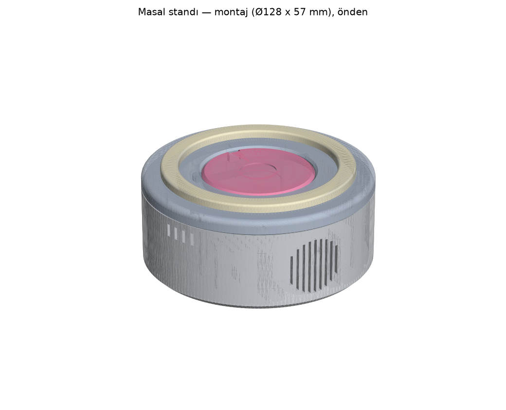

# Masal standı — 3B tasarım (parametrik, Python)

Masa üstü yuvarlak stand: **Ø128 × 57,3 mm** (+ ~2,5 mm silikon ayak). Çocuk figürü üstteki yuvaya koyar,
yuvanın altındaki RC522 figür tabanındaki NTAG213 etiketini okur, çevredeki NeoPixel halka difüzörün altından
parlar, önde hoparlör, arkada USB-C güç girişi ve mikrofon deliği. Elektronik, bağlantı, güç ve test:
`docs/DONANIM.md`.



| Dosya | Ne |
|---|---|
| `parametreler.py` | **Bütün ölçüler** (tek yer). Değiştirip `uret.py`'yi çalıştırın. |
| `parcalar.py` | Parçaların geometrisi (manifold3d CSG) + içteki elektronik zarfları + montaj konumları |
| `geometri.py` | Yardımcılar (döndürme profili, yuvarlatılmış dikdörtgen, yay üstüne Türkçe yazı, yıldız/hilal) |
| `uret.py` | STL'ler + denetim raporu + önizlemeler + teknik çizimler (hepsi tek komut) |
| `onizleme.py`, `cizim.py` | PNG önizlemeler (matplotlib) ve A3 1:1 teknik çizimler (SVG + PDF) |
| `stl/` | `govde_alt.stl`, `ust_kapak.stl`, `difuzor_halka.stl`, `rc522_tutucu.stl`, `figur_taban.stl` (yazısız), `ayar_karti.stl`, `figurler/<kimlik>.stl` (12 adlı taban) |
| `teknik_cizim.svg/.pdf` | Üst görünüş, kesit A–A (yan, istif), kesit B–B (yerleşim), ölçüler, delik konumları, parça listesi |
| `patlatilmis_montaj.svg/.pdf` | Patlatılmış kesit + montaj sırası + izometrik patlatılmış görünüş |
| `kontrol_raporu.md` | Üretilen denetim: su geçirmezlik, hacim, baskı tahmini, montaj çakışmaları, ölçü kuralları |
| `onizleme/` | `montaj_izometrik`, `montaj_arka`, `montaj_patlatilmis`, `montaj_kesit`, `govde_ic_yerlesim`, `parca_*`, `figur_tabanlari` |

## Yeniden üretmek

```bash
python3 -m venv cad/.venv            # (Windows: py -3.11 -m venv cad\.venv)
cad/.venv/bin/pip install -r cad/requirements.txt     # ~400 MB; OpenGL/ekran kartı gerekmez
cad/.venv/bin/python cad/uret.py      # ~10 s: stl/, onizleme/, teknik çizimler, kontrol_raporu.md
cad/.venv/bin/python cad/uret.py --stl   # yalnız STL + denetim
python3 docs/donanim/ciz_baglanti.py  # bağlantı ve blok şeması (yalnız standart kütüphane)
```

Figür tabanları `data/figur_donanim.json`'dan üretilir: her figür için `stl/figurler/<kimlik>.stl`, adı üst
kenara kazınmış (yayın üstünde, öne okunur; Türkçe harfler için DejaVu Sans Bold), altta `No <nfc_no>` (aynalı,
alttan okunur). Yeni figür eklenince yalnız `uret.py`'yi çalıştırın. **Gece figürü** (`mod: "uyku"`, Ay Dede):
`gece.stl`'de "AY DEDE" + arka yarıda hilal ve üç yıldız. Yazı tipi matplotlib'in içindeki DejaVu Sans Bold
(`parametreler.YAZI_FONT`): Windows/Mac/Linux'ta aynı çıktı.

Denetim (`kontrol_raporu.md`, son çalıştırma: **HATA YOK**):
- her STL diskte yeniden okunup su geçirmez + tutarlı yüz yönü + pozitif hacim;
- montajda basılan parçalar arası çakışma 0 (temas eden yüzeyler hariç);
- 14 elektronik zarfı (DevKit + headerlar, anten, taşıyıcı, seviye çevirici/1000 µF, amp, hoparlör, USB-C,
  INMP441, RC522 ve bileşenleri, halka, NTAG213) hiçbir duvarla kesişmez; en yakın boşluk raporda;
- kurallar: halka kanalı Ø89,2/Ø104,8 ⊃ halka Ø90/Ø104; kanal derinliği; ışık boşluğu 5 mm; difüzör 1,8 mm;
  yuva tabanı 1,8 mm ≤ 2; RC522 anten merkezi = yuva merkezi; NFC mesafesi ≈ 3,6 mm; toplam yükseklik;
  USB-C fiş–soket aralığı 1,3 mm; mikrofon–hoparlör 127 mm; vida boyu.

## Baskı ayarları

0,4 mm meme. Hiçbir parça destek istemez; hepsi STL'deki yönüyle basılır (Z yukarı, alt yüz tablada).

| Parça | Malzeme | Renk | Katman | Duvar / üst-alt | Dolgu | Yön | ~Süre / filament* |
|---|---|---|---|---|---|---|---|
| `govde_alt.stl` | PETG (ya da PLA) | açık renk, opak | 0,2 | 3 çevre / 5 kat | %15 gyroid | taban tablada | ~3,5–5 sa / ~76 g |
| `ust_kapak.stl` | PETG (ya da PLA) | **opak** (ışık kanaldan sızmasın), açık renk | 0,2 | 3 / 5 | %15 | alt yüz tablada | ~2–3 sa / ~41 g |
| `difuzor_halka.stl` | **PETG doğal/beyaz yarı saydam** | beyaz yarı saydam | 0,2 | 2 çevre, %100 dolgu (ya da "vase" değil) | %100 | etekler tablada | ~0,5 sa / ~11 g |
| `rc522_tutucu.stl` | PLA/PETG | herhangi | 0,2 | 3 / 4 | %30 | düz | ~0,1 sa / 3 g |
| `figurler/*.stl`, `figur_taban.stl` | PLA/PETG | figür rengi (`data/figur_donanim.json`) | 0,16 (yazı için) | 3 / 5 | %30 | etiket cebi tablada | ~0,6 sa / 11 g |
| `ayar_karti.stl` | PLA/PETG | turkuaz | 0,16 | 3 / 5 | %30 | alt tablada | ~0,8 sa / 14 g |

\* Kaba tahmin (6 mm³/s); dilimleyicinin değerine bakın. Kazıma yazılar için ilk/son katmanda "ironing" güzel
sonuç verir. Difüzörde yarı saydamlık için 0,2 katman + %100 dolgu + çizgisel desen; ışık daha eşit dağılsın
istenirse 1,2 mm'ye inilebilir (`DIF_KAL`). PLA 50 °C üstünde yumuşar: gövde ve kapak için PETG önerilir
(kutu içinde ESP32 + LDO ısısı).

## Montaj sırası (kısa)

Ayrıntı ve test: `docs/DONANIM.md` bölüm 8–9; çizim: `patlatilmis_montaj.svg`.

1. Alt gövde: 3 silikon ayak; USB-C kartını platforma epoksiyle (soket ağzı duvar cebine dayalı), kabloyu arka
   köprüye kablo bağıyla.
2. Hoparlör (1 mm köpük conta) ön bölmeye üstten; arkasına 3 mm köpük; 4 nokta silikon.
3. MAX98357A dikey kızağa üstten; INMP441 (conta + kart) arka üstteki yuvaya üstten.
4. Taşıyıcı pertinaks 4 köşe kenetine; DevKit dişi headerlara.
5. Kapağa 3 × M3 ısıl gömme somun; RC522 (bileşen yüzü aşağı) tutucuya, tutucu 4 × M2,5×8 ile kapağa.
6. Halka kanala (kablo arka yarıktan), difüzör üstüne (tırnak oturur, isteğe bağlı 3 nokta silikon).
7. Kabloları tak, test et, kapağı dil–oluk ile oturt (vidalar tek yönde hizalanır), alttan 3 × M3×10.
8. Tabanlara NTAG213 (alt cep), figürleri üste yapıştır.

## Tasarım kararları

- **Hoparlör önde, yandan yayan:** çocuğa doğru; Ø40 hoparlör düz bir bölmeye köpük contayla dayanır, önünde Ø35
  hava odası, dış duvarda 1,6 mm dikey yarıklar (parmak girmez, desteksiz basılır). Tabandan yayan seçenek
  halıda/yatakta boğulur ve ayakların yüksek olmasını (ya da tabanın köprüyle basılmasını) gerektirirdi.
- **Mikrofon arkada üstte** (250°, z = 36): hoparlörden ~127 mm; düz ped + Ø7 conta yuvası + 1 mm delik + dış
  havşa (≈ 3 mm port). Kart üstten kayan yuvada.
- **NFC:** yuva tabanı 1,8 mm; RC522 bileşen yüzü aşağı, düz arka yüzü kapağa yaslı (tutucu çerçeve); etiket
  taban altındaki 0,4 mm cepte → etiket–anten ≈ 3,6 mm. Taban Ø62, yuva Ø62,8 (0,4 radyal) + 1,2 mm pahlı ağız;
  arkadaki 6 mm kama figürü öne çevirir (`ANAHTAR_VAR = False` ile kaldırılabilir — kama oturmasa bile etiket
  8,6 mm'den okunur).
- **Halka:** kanal Ø89,2–Ø104,8 × 4,3 mm (halka 3,5 mm + 0,8), üstünde 1,2 mm omuz; difüzör ters U kesitli, LED'lerden
  5 mm yukarıda (35 LED'de aralık ~8,7 mm: noktalar yumuşar), kapaktan 4,3 mm yükselen parlayan hale; dış
  eteğinde çevresel 0,4 mm tırnak.
- **Sabitleme (delik tahmini yok):** ESP32 kartında montaj deliği yok, RC522/INMP441/kopya amp delikleri
  yayımlanmamış → DevKit 5×7 pertinaksta dişi headerla (çıkarılabilir), pertinaks 4 köşe esnek kenetle; amp ve
  mikrofon üstten kayan U-yuvalarda; RC522 çerçeveyle; USB-C kartı epoksi + arka dayanak (fiş takma kuvvetini
  gövde taşır). Kapak–gövde: dil–oluk (0,2 boşluk) + 3 × M3 ısıl gömme somun, vidalar alttan derin havşada.
- **Çocuk güvenliği:** dış kenarlar kapakta R3, tabanda 3×45° pah; dıştan erişilen açıklıklar ≤ 2 mm (ızgara 1,6,
  havalandırma 1,8–2,0, mikrofon 1; USB-C soketi hariç); vidalar gizli; küçük ayrılabilir parça yok (difüzör tırnaklı + silikon,
  ayaklar yuvada). Figür tabanı Ø62 (yutma silindiri Ø31,7'den büyük).

## Parametreler (özet; hepsi `parametreler.py`)

| Parametre | Değer | Anlamı |
|---|---|---|
| `D_DIS`, `H_ALT`, `KAPAK_KAL` | 128, 45, 8 | dış çap, alt gövde yüksekliği, kapak kalınlığı |
| `DUVAR`, `TABAN` | 2,5, 2,5 | duvar ve taban kalınlığı |
| `ALT_PAH`, `KAPAK_UST_YUVARLAK` | 3, 3 | çocuk güvenliği kenarları |
| `VIDA_R`, `VIDA_ACILAR` | 57, (0°, 135°, 225°) | M3 vida çemberi (ön hoparlörü, arka USB'yi serbest bırakır) |
| `INSERT_D`, `INSERT_DERIN` | 4,0, 6,0 | M3×5,7 ısıl gömme somun deliği |
| `YUVA_TABAN_KAL` | 1,8 | anten üstündeki plastik (≤ 2) |
| `TABAN_D`, `TABAN_H`, `YUVA_PAY` | 62, 6, 0,4 | figür tabanı ve yuva boşluğu |
| `ANAHTAR_VAR`, `ANAHTAR_G`, `ANAHTAR_DERIN` | True, 6, 3 | yuvadaki kama |
| `HALKA_DIS_D`, `HALKA_IC_D`, `HALKA_KAL`, `HALKA_PAY` | 104, 90, 3,5, 0,4 | NeoPixel halka ve kanal boşluğu |
| `ISIK_BOSLUGU`, `DIF_KAL` | 5, 1,8 | LED → difüzör, difüzör kalınlığı |
| `ETIKET_CEP_D`, `ETIKET_CEP_DERIN` | 25,6, 0,4 | NTAG213 Ø25 cebi |
| `YAZI_BOY`, `YAZI_DERIN`, `YAZI_R` | 5,5, 0,6, 27 | taban yazısı |
| `HOPARLOR_D`, `HOPARLOR_DERIN`, `HOP_YUZ_Y` | 40, 20, 56 | hoparlör ve bölme düzlemi |
| `IZGARA_D`, `IZGARA_YARIK`, `IZGARA_ADIM` | 33, 1,6, 3,4 | ızgara |
| `MIK_ACI`, `MIK_Z`, `MIK_PCB_D`, `MIK_YUVA_BOSLUK` | 250°, 36, 14,5, 3 | mikrofon yeri ve yuvası |
| `USBC_KART_*`, `USBC_Z`, `USBC_ON_Y`, `USBC_DIS_DUZ` | 20,4×14,2×5, 10, −62,3, −63,6 | USB-C kartı, soket yüksekliği, cep ve dış alın |
| `TASIYICI`, `TASIYICI_MERKEZ`, `TASIYICI_Z` | 50×70, (0, −7), 7 | taşıyıcı pertinaks ve kenet kızağı |
| `AMP_KART`, `AMP_X`, `AMP_Y0`, `AMP_TABAN_Z` | 17,8×19,4, 38, 9,5, 11,5 | MAX98357A dikey kızak |
| `RC522`, `RC522_ANTEN_KAYMA`, `RC_VIDALAR` | 60×39,5, 10, 4 vida | RC522, anten merkezi kayması (**kartla doğrulayın**), tutucu vidaları |

## Doğrulanamayanlar

- RC522 anten merkezi ve delikleri (yayımlanmamış) → `RC522_ANTEN_KAYMA` kartınızdan ölçülmeli; tutucu delik
  kullanmaz.
- INMP441 kart çapı/kalınlığı ve ses deliğinin yüzü (satıcıya göre) → yuva boşluklu; delikli yüz duvara.
- MAX98357A kopyalarının boyu (17,8 / 19,4) → `AMP_KART`.
- USB-C kopya kartlarında soketin kart kenarından taşması → `USBC_ON_Y`.
- Hoparlör çerçeve biçimi → raylar + köpük + silikon; Ø50 hoparlör için `HOPARLOR_D = 50` ve `H_ALT` ≥ 55 gerekir.
- Baskı süresi/filament tahmini kabadır; ısıl gömme somun deliği (Ø4,0) somun markasına göre ±0,2 değişir.
- Önizlemeler matplotlib ile çizilir (ressam algoritması): uzaktan görünüm içindir; ölçü için STL ve teknik çizim.
