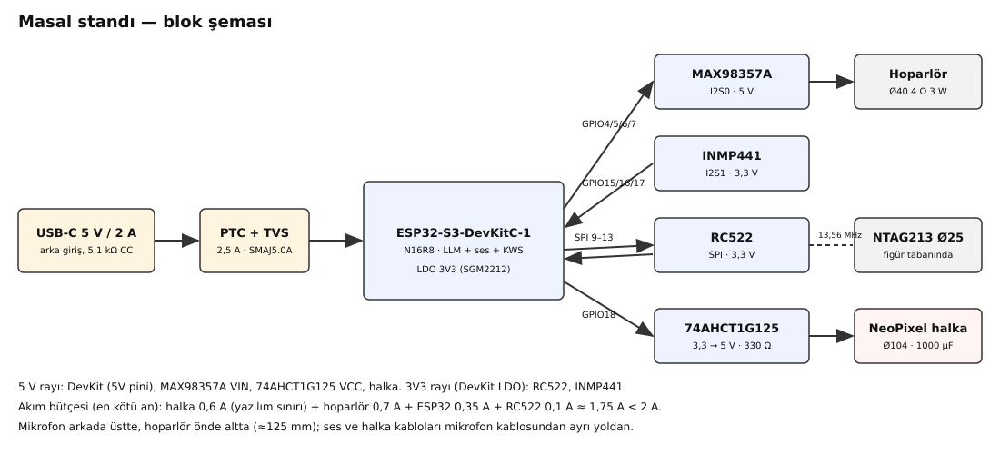
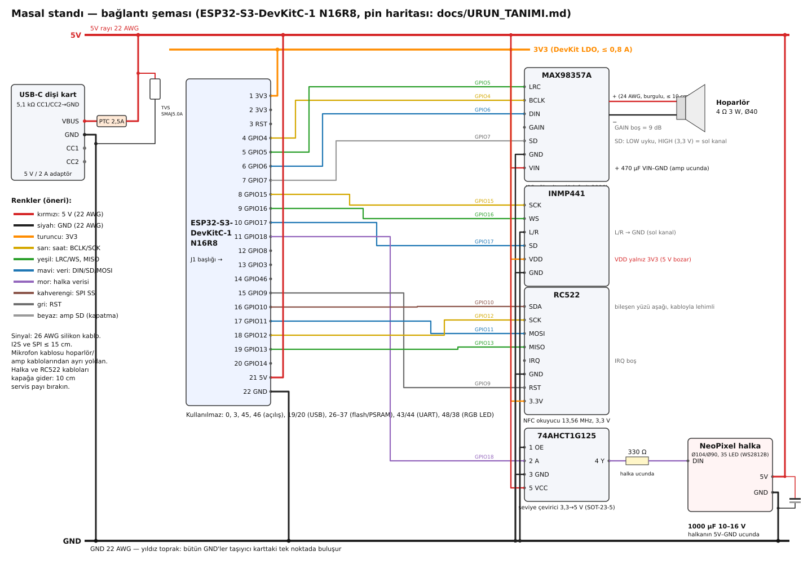

# Masal standı — donanım: parça listesi, bağlantı, güç, montaj ve test

Bu belge `docs/URUN_TANIMI.md`'deki kesin pin haritasına ve davranışlara uyar. Kutunun 3B tasarımı `cad/`
(bkz. `cad/README.md`), bağlantı şeması `docs/donanim/baglanti.svg`, blok şeması `docs/donanim/blok.svg`
(ikisi de `python docs/donanim/ciz_baglanti.py` ile üretilir; elle düzenlemeyin).

## 1. Kısaca

- Yuvarlak masa üstü stand: **Ø128 mm, 57,3 mm yükseklik** (+ ~2,5 mm silikon ayak). Üstte figür yuvası (Ø62,8),
  çevresinde parlayan halka (NeoPixel Ø104/Ø90 + yarı saydam difüzör), önde hoparlör ızgarası, arkada USB-C güç
  girişi ve 1 mm mikrofon deliği. Düğme yok; vidalar alttan, derin havşada gizli.
- Çocuk figürü yuvaya koyar → yuvanın 1,8 mm altındaki RC522, figür tabanındaki NTAG213 etiketini okur
  (etiket–anten ≈ 3,6 mm) → halka figür renginde dolar → hikâye hoparlörden okunur. "Merhaba Eko" INMP441 ile.
- Gece figürü (**Ay Dede**, nfc_no 12): tabanı `cad/stl/figurler/gece.stl` ("AY DEDE" + hilal ve üç yıldız
  kazıması). Konunca ninni modu; halka gece mavisi, yavaş parıldayan yıldızlar (yazılım işi, URUN_TANIMI.md).
- Ayar kartı (nfc_no 200): `cad/stl/ayar_karti.stl` (topuzlu taban, "AYAR").

## 2. Parça listesi

Türkiye'de Robotistan, Direnc.net, Robotzade, Özdisan, Trendyol/Hepsiburada'da "arama" sütunundaki adlarla
aranır. Fiyat yazılmadı (kur hızlı değişiyor).

| No | Parça | Tam model / özellik | Adet | Arama | Not |
|---|---|---|---|---|---|
| 1 | Mikrodenetleyici kartı | **ESP32-S3-DevKitC-1 N16R8** (16 MB flash, 8 MB OPI PSRAM, WROOM-1 PCB antenli) | 1 | `ESP32-S3-DevKitC-1 N16R8` | N8R2/N8 olmaz. Başlıkları lehimli gelirse iyi (taşıyıcıya takılır). Kopya kartlarda ölçü birkaç mm farklı olabilir (bkz. 3) |
| 2 | I2S ses yükselteci | **MAX98357A** kartı (Adafruit 3006 ya da eşdeğeri, 7 uçlu) | 1 | `MAX98357A I2S amfi modülü` | 5 V'ta 4 Ω'a 3 W (%10 THD) |
| 3 | Hoparlör | **40 mm, 4 Ω, 3 W**, yuvarlak, gövde derinliği ≤ 21 mm (örn. Adafruit 3968: Ø40×20; PUI AS04004PR-R: Ø40×18,3) | 1 | `40mm 4 ohm 3W hoparlör` | 8 Ω da çalışır (daha az ses). Kulaklı/vidalı çerçeveliler sığmayabilir |
| 4 | Mikrofon | **INMP441** I2S MEMS mikrofon kartı (yuvarlak ~Ø14, 6 uç) | 1 | `INMP441 mikrofon modülü` | **Yalnız 3,3 V** |
| 5 | NFC okuyucu | **RC522** (MFRC522, mavi kart ~60×39,5 mm) | 1 | `RC522 RFID NFC modül` | "Mini RC522" (25×37) bu tasarıma uymaz |
| 6 | NFC etiketi | **NTAG213 Ø25 mm** yapışkanlı etiket | figür başına 1 (+ yedek) | `NTAG213 25mm NFC etiket` | 0,2–0,3 mm; kâğıt yüzlü ya da PET |
| 7 | Seviye çevirici | **SN74AHCT1G125** (SOT-23-5) + **SOT-23 → DIP adaptör kartı**; *ya da* **74AHCT125N** (DIP-14) | 1 | `74AHCT1G125` / `74AHCT125 DIP` / `SOT23 DIP adaptör` | 74AHCT125N'de kullanılmayan girişler (2A,3A,4A) GND'ye, 2–4 OE VCC'ye (çıkış kapalı) |
| 8 | NeoPixel halka | WS2812B uyumlu, **dış Ø104 / iç Ø90 / 3,5 mm**, 5 V (LED sayısı yazılımda `HALKA_LED_SAYISI`) | 1 | `WS2812B halka 104mm` | Ürün sahibinde mevcut |
| 9 | Güç girişi | **USB-C dişi kart, CC1 ve CC2'de 5,1 kΩ GND'ye** (örn. Adafruit 4090: 20,4×14,2×5,0 mm) | 1 | `USB Type-C dişi breakout 5.1k` | 5,1 kΩ yoksa C-C kablolu adaptör 5 V VERMEZ: iki 5,1 kΩ'u siz lehimleyin |
| 10 | Adaptör | **5 V 2 A USB** adaptör + USB-C kablo (≤ 1,5 m, kalın) | 1 | `5V 2A USB-C adaptör` | CE işaretli, kısa devre korumalı |
| 11 | Taşıyıcı kart | **5×7 cm çift yüzlü delikli pertinaks** (1,6 mm) | 1 | `5x7 cm çift taraflı delikli pertinaks` | Kutuya 4 köşe kenetiyle oturur (delik gerekmez) |
| 12 | Dişi header | 2,54 mm **1×22 dişi pin header** (ya da 1×20 + 1×2) | 2 | `dişi pin header 2.54 1x40` (kesilir) | DevKit taşıyıcıya takılır, çıkarılabilir |
| 13 | Konnektör | JST-XH 2,54 erkek/dişi set (2, 3, 6, 8 uçlu) *ya da* doğrudan lehim | 1 set | `JST XH 2.54 konnektör seti` | Kapak ayrılabilsin diye halka ve RC522 kablosu konnektörlü önerilir |
| 14 | Kondansatör | **1000 µF 10–16 V** elektrolitik (Ø8–10 mm) | 1 | `1000uF 16V kondansatör` | Halkanın 5V–GND ucunda |
| 15 | Kondansatör | **470 µF 10–16 V** elektrolitik + **100 nF** seramik | 1+2 | `470uF 16V`, `100nF seramik` | Yükseltecin VIN–GND'sinde; 100 nF'ler çevirici ve RC522 3,3 V'una |
| 16 | Direnç | **330 Ω** 1/4 W | 1 | `330 ohm direnç` | Halka DIN'ine seri, halka ucunda (makaron içinde) |
| 17 | Sigorta (önerilir) | **PTC 2,5 A tutma / 5 A atma**, ≥ 6 V (örn. Bourns MF-R250) | 1 | `PTC resettable sigorta 2.5A` | 5 V girişinde, iç kısa devreye karşı |
| 18 | TVS diyot (önerilir) | **SMAJ5.0A** (tek yönlü, 5 V) | 1 | `SMAJ5.0A TVS diyot` | USB-C VBUS–GND, kartın hemen yanında |
| 19 | Kablo | Silikon kablo **22 AWG** (kırmızı, siyah) ve **26 AWG** (renkli) | ~1 m + ~3 m | `22 AWG silikon kablo`, `26 AWG silikon kablo` | 24 AWG burgulu çift hoparlöre |
| 20 | Isıl gömme somun | **M3 × 5,7 mm** (dış Ø~4,6) pirinç insert | 3 | `M3 heat set insert 5.7mm` | Kapağa havya ile (delik Ø4,0) |
| 21 | Vida | **M3 × 10** silindir başlı (DIN 912/7984) | 3 | `M3x10 imbus vida` | Alttan, kapak–gövde |
| 22 | Vida | **M2,5 × 8** sac vidası (plastik için) | 4 | `M2.5x8 sac vidası` | RC522 tutucu → kapak (pilot Ø2,0) |
| 23 | Ayak | Yapışkanlı silikon ayak **Ø12,7 × 3,5 mm** | 3 | `yapışkanlı silikon ayak 12.7mm` | Tabandaki 1 mm'lik yuvalara |
| 24 | Köpük | 1 mm ve 3 mm **EVA/PE köpük bant** | 1+1 | `1mm EVA köpük bant` | Hoparlör contası, mıknatıs arkası, mikrofon contası (Ø7 halka, ortası Ø2 delik) |
| 25 | Filament | PETG ya da PLA (gövde, kapak); **doğal/beyaz yarı saydam PETG** (difüzör) | ~200 g + 15 g | `PETG natural filament` | Tabanlar figür renginde |
| 26 | Keçe (isteğe bağlı) | Yapışkanlı keçe Ø30, ≤ 0,5 mm | figür başına 1 | `yapışkanlı keçe` | Etiketi korur, yüzeyi çizmez (NFC mesafesine +0,5 mm) |

## 3. Parça ölçüleri (kaynaklı) ve doğrulanamayanlar

| Parça | Tasarımda kullanılan ölçü | Kaynak |
|---|---|---|
| ESP32-S3-DevKitC-1 | PCB **62,74 × 25,40 mm**, başlık sıraları kenardan 1,27 mm (sıra arası 22,86 mm, 2,54 adım), USB uçta 8 mm boşluk; WROOM-1 anteni kartın ucundan ~7 mm taşar (çizimden ölçüldü); **montaj deliği yok** | Espressif PCB çizimi: <https://dl.espressif.com/dl/PCB_ESP32-S3-DevKitC-1_V1_20210312CB.pdf>; J1/J3 uç sırası: <https://docs.espressif.com/projects/esp-dev-kits/en/latest/esp32s3/esp32-s3-devkitc-1/user_guide_v1.1.html> |
| DevKit 5V pini | USB VBUS → **1N5819HW Schottky** → VCC_5V (= J1-21); 3,3 V **SGM2212** LDO | Şema: <https://dl.espressif.com/dl/SCH_ESP32-S3-DEVKITC-1_V1_20210312C.pdf> |
| MAX98357A (Adafruit 3006) | **19,4 × 17,8 × 3,0 mm**; 5 V/4 Ω: 3,2 W (%10 THD); SD: < 0,16 V kapalı, 0,16–0,77 V (L+R)/2, 0,77–1,4 V sağ, > 1,4 V sol; kartta SD–VIN 1 MΩ; GAIN boş = 9 dB | <https://www.adafruit.com/product/3006>, <https://learn.adafruit.com/adafruit-max98357-i2s-class-d-mono-amp/pinouts> |
| Hoparlör 40 mm 4 Ω | **Ø40 × 20 mm** (Adafruit 3968, 4 Ω, 9 cm kablolu); PUI AS04004PR-R Ø40 × 18,3 mm, 3 W | <https://www.adafruit.com/product/3968>, <https://puiaudio.com/product/s/AS04004PR-R> |
| INMP441 kartı | yuvarlak **~Ø14–15 mm**, 2×3 uç (2,54; sütunlar 7,62 mm arayla), alttan portlu MEMS; besleme satıcılara göre 1,8–3,3 V | <https://components101.com/modules/inmp441-mems-omnidirectional-microphone>, <https://git.cuvoodoo.info/kingkevin/qeda_library/src/branch/master/sensor/microphone-i2s-inmp441.yaml>, <https://www.tinytronics.nl/nl/sensoren/geluid/inmp441-mems-microfoon-i2s> |
| RC522 | **~60 × 39,5 mm** (40×60 olarak da satılır), delik Ø3; MFRC522 13,56 MHz, okuma ~50 mm'ye kadar (anten/ayara bağlı) | <https://forum.arduino.cc/t/mifare-rc522-rfid-reader-board-size/528594>, <https://www.nxp.com/docs/en/data-sheet/MFRC522.pdf> |
| 74AHCT1G125 | SOT-23-5: **1 OE, 2 A, 3 GND, 4 Y, 5 VCC**; VCC 4,5–5,5 V; VIH 2 V (3,3 V sürer); ±8 mA, 6 ns | TI: <https://www.ti.com/lit/ds/symlink/sn74ahct1g125.pdf>; DIP-14 seçeneği: <https://www.adafruit.com/product/1787> |
| USB-C kartı | Adafruit 4090: **20,4 × 14,2 × 5,0 mm**, VBUS/GND/D+/D−/CC, CC'de 5,1 kΩ | <https://www.adafruit.com/product/4090> |
| NTAG213 Ø25 | kalınlık **0,2–0,28 mm** | <https://store.gototags.com/nfc-sticker-ntag213-25-mm-circle/> |
| NeoPixel halka | Ø104/Ø90 × 3,5 mm (ürün sahibinin ölçüsü) | `docs/URUN_TANIMI.md` |

**Doğrulanamayanlar ve tasarımdaki karşılığı** (delik konumu tahmin edilmedi; hepsi kızak/kenet/tutucu ile):
- RC522 delik konumları ve **anten merkezi** yayımlanmamış. Tasarım anten merkezini kart merkezinden 10 mm uzak uca
  kaymış varsayar (`cad/parametreler.py` → `RC522_ANTEN_KAYMA`). Kartınızda bakır sargının ortasını ölçüp
  parametreyi düzeltin; 3 mm'lik hata NFC'yi bozmaz (etiket Ø25, mesafe 3,6 mm).
- INMP441 çapı ve kalınlığı satıcıya göre 14–15 mm / 1,0–1,6 mm: yuva 14,5 mm + 3 mm (conta + PCB) boşluklu,
  üstten kayar. Mikrofonun ses deliğinin hangi yüzde olduğu karttan karta değişebilir: **delikli yüz duvara bakar**.
- MAX98357A kopyalarında boy 17,8–19,4 arası: dikey U-raylar 18,3 mm (17,8 kenar yatay); 19,4 kenarlı kopyada
  `AMP_KART` değiştirilir.
- DevKit kopyaları (YD-ESP32-S3 vb.) farklı boyda olabilir: DevKit doğrudan kutuya değil, taşıyıcı pertinaksa
  dişi headerla takıldığı için kutu değişmez; yalnız taşıyıcıdaki header yerleri değişir.
- Hoparlör çerçevesi (kulaklı/kulaksız) ve derinliği: ön bölme + yan raylar Ø40'ı kılavuzlar, arka dayanak 3 mm
  köpükle 18–21 mm derinliği karşılar; 4 nokta silikonla sabitlenir.
- USB-C kartının soket ağzı kart kenarıyla aynı hizada varsayıldı (Adafruit 4090). Kopyada soket taşıyorsa
  `USBC_ON_Y` ile cebi ayarlayın; fiş gövdesi ile soket ağzı arası 1,3 mm (≤ 1,5 mm olmalı).

## 4. Bağlantı

Kart üstündeki bütün kullanılan uçlar **J1** başlığındadır (J1-1 … J1-22). Kablo kesitleri: güç 22 AWG,
sinyal 26 AWG silikon, hoparlör 24 AWG burgulu çift. Uzunluklar kutudaki konumlardan (cad/) hesaplandı, +3 cm pay.

### 4.1 Güç

| # | Nereden | Nereye | Renk | Kesit | Uzunluk | Not |
|---|---|---|---|---|---|---|
| G1 | USB-C kartı VBUS | PTC (2,5 A) → taşıyıcı **5V yıldız noktası** | kırmızı | 22 AWG | 8 cm | Kablo bağıyla platform arkasındaki köprüye bağlanır (gerilme önleyici) |
| G2 | USB-C kartı GND | taşıyıcı **GND yıldız noktası** | siyah | 22 AWG | 8 cm | G1 ile burgulu |
| G3 | TVS SMAJ5.0A | USB-C kartında VBUS (katot) – GND (anot) | — | bacak | — | Soketin dibine |
| G4 | 5V yıldız | DevKit **J1-21 (5V)** | kırmızı | 22 AWG | taşıyıcıda | DevKit bu pinden beslenir; DevKit'in USB'si diyotlu (1N5819HW), geri besleme olmaz |
| G5 | GND yıldız | DevKit **J1-22 (GND)** | siyah | 22 AWG | taşıyıcıda | |
| G6 | 5V yıldız | MAX98357A **VIN** | kırmızı | 22 AWG | 12 cm | VIN–GND'ye amp ucunda 470 µF + 100 nF |
| G7 | GND yıldız | MAX98357A **GND** | siyah | 22 AWG | 12 cm | G6 ile burgulu, ayrı dönüş (yıldız) |
| G8 | 5V yıldız | Halka **5V** | kırmızı | 22 AWG | 22 cm | Kapağa gider (konnektörlü), halka ucunda **1000 µF** |
| G9 | GND yıldız | Halka **GND** | siyah | 22 AWG | 22 cm | G8 ile burgulu |
| G10 | 5V yıldız | 74AHCT1G125 **5 VCC** | kırmızı | 26 AWG | taşıyıcıda | 100 nF VCC–GND |
| G11 | GND | 74AHCT1G125 **3 GND** ve **1 OE** | siyah | 26 AWG | taşıyıcıda | OE LOW = çıkış açık |
| G12 | DevKit **J1-1 (3V3)** | INMP441 **VDD** | turuncu | 26 AWG | 18 cm | 5 V BAĞLAMAYIN |
| G13 | GND | INMP441 **GND** ve **L/R** | siyah | 26 AWG | 18 cm | L/R mikrofon kartında GND'ye köprü (sol kanal) |
| G14 | DevKit **J1-2 (3V3)** | RC522 **3.3V** | turuncu | 26 AWG | 22 cm | Kapağa gider; RC522 ucunda 100 nF |
| G15 | GND | RC522 **GND** | siyah | 26 AWG | 22 cm | |

### 4.2 Sinyaller (pin haritası URUN_TANIMI.md ile aynı)

| # | DevKit ucu | GPIO | Nereye | Renk | Kesit | Uzunluk |
|---|---|---|---|---|---|---|
| S1 | J1-4 | 4 | MAX98357A **BCLK** | sarı | 26 AWG | 12 cm |
| S2 | J1-5 | 5 | MAX98357A **LRC** | yeşil | 26 AWG | 12 cm |
| S3 | J1-6 | 6 | MAX98357A **DIN** | mavi | 26 AWG | 12 cm |
| S4 | J1-7 | 7 | MAX98357A **SD** | beyaz | 26 AWG | 12 cm |
| S5 | J1-8 | 15 | INMP441 **SCK** | sarı | 26 AWG | 18 cm |
| S6 | J1-9 | 16 | INMP441 **WS** | yeşil | 26 AWG | 18 cm |
| S7 | J1-10 | 17 | INMP441 **SD** | mavi | 26 AWG | 18 cm |
| S8 | J1-11 | 18 | 74AHCT1G125 **2 A** | mor | 26 AWG | taşıyıcıda |
| S9 | 74AHCT1G125 **4 Y** | — | **330 Ω** → halka **DIN** | mor | 26 AWG | 22 cm (direnç halka ucunda, makaronlu) |
| S10 | J1-16 | 10 | RC522 **SDA (SS)** | kahverengi | 26 AWG | 22 cm |
| S11 | J1-18 | 12 | RC522 **SCK** | sarı | 26 AWG | 22 cm |
| S12 | J1-17 | 11 | RC522 **MOSI** | mavi | 26 AWG | 22 cm |
| S13 | J1-19 | 13 | RC522 **MISO** | yeşil | 26 AWG | 22 cm |
| S14 | J1-15 | 9 | RC522 **RST** | gri | 26 AWG | 22 cm |
| S15 | — | — | RC522 **IRQ**: boş; MAX98357A **GAIN**: boş (9 dB) | — | — | — |
| S16 | MAX98357A **+ / −** | — | Hoparlör + / − | kırmızı/siyah burgulu | 24 AWG | 10 cm |

Notlar:
- **SD (GPIO7):** LOW = yükselteç kapalı (sessizlikte hışırtı ve akım yok). HIGH (3,3 V > 1,4 V) yükselteci
  **sol kanala** alır; yazılım iki kanala aynı örneği yazdığından duyulan ses değişmez. SD bağlanmazsa (boş)
  kartın 1 MΩ çekmesiyle (L+R)/2 çalışır.
- Kullanılmayan uçlar: 0, 3, 45, 46 (açılış), 19/20 (USB), 26–37 (flash/PSRAM), 43/44 (UART), 48/38 (kart LED'i).
- İsteğe bağlı tek kabloyla güncelleme: D+/D− uçlu USB-C kartında (Adafruit 4090) D+ → J3-19 (GPIO20), D− → J3-20
  (GPIO19) burgulu 10 cm bağlanırsa arka USB-C'den de yazılım yüklenir (DevKit'in kendi USB'siyle paralel; ikisini
  aynı anda takmayın). Bilgisayar USB'si 0,5–0,9 A verir: bu sırada halka sönük, ses kısık kalmalı.

## 5. Güç bütçesi (5 V, 2 A adaptör)

| Tüketici | Normal (okuma) | En kötü an | Dayanak |
|---|---|---|---|
| NeoPixel halka (35 LED) | 0,05–0,25 A | **0,60 A** (yazılım sınırı `HALKA_AKIM_SINIR_MA`; %25 parlaklık tavanı) | Tam beyaz %100 olsa 35 × 60 mA = 2,1 A — yazılım asla izin vermez; LED başı ~1 mA boşta |
| MAX98357A + hoparlör | 0,10–0,25 A ortalama | **0,75 A** tepe (3 W / 5 V / %85 verim) | Adafruit 3006: 5 V'ta "en az 800 mA" önerisi |
| ESP32-S3 (LLM iki çekirdek + PSRAM) | 0,25–0,35 A | **0,35 A** (Wi-Fi ayar modunda kısa tepeler ~0,5 A; o modda LLM durur) | firmware README "Güç" |
| RC522 | 0,02–0,03 A | 0,10 A | MFRC522 verici |
| INMP441 + 74AHCT1G125 | < 0,002 A | < 0,002 A | |
| **Toplam** | **~0,5–0,9 A** | **≈ 1,8 A** | 2 A'nın altında (%10 pay); kablo/konnektör kaybı ~0,1 V |

- 3V3 rayı DevKit'in SGM2212 LDO'sundan (0,8 A): ESP32 + RC522 + INMP441 ≈ 0,45 A en çok. LDO'da
  (5 − 3,3) × 0,4 ≈ 0,7 W ısı: DevKit'in modül altı ılık olur, normal.
- Brownout olursa (README): sesi kıs, halka tavanını düşür; adaptör ve kabloyu değiştir. Yazılıma öneri: ses
  tepedeyken halka akım sınırını 0,4 A'e çek (toplam en kötü an ~1,6 A).

## 6. Koruma

- **1000 µF** halkanın 5V–GND'sinde (açılış akım darbesi ve LED titreşimi); **330 Ω** halka DIN'inde, halkaya
  yakın (yansıma ve ilk LED'in giriş koruması).
- **470 µF + 100 nF** yükseltecin VIN–GND'sinde (ses tepelerinde gerilim çökmesi).
- **PTC 2,5 A** (önerilir): iç kısa devrede ince kabloları ve USB-C kartını korur; adaptör kendi korumasına
  sahip olsa da kablo içerdedir. 1,8 A tepe 2,5 A tutmanın altında (40 °C'de bile atmaz).
- **SMAJ5.0A TVS** (önerilir): USB-C girişinde takıp çıkarma ve elektrostatik boşalmaya karşı.
- **ESD:** Kutu tamamen plastik; dokunulabilen tek metal USB-C kabuğu (GND). Mikrofon deliği 1 mm, ızgara
  yarıkları 1,6 mm, halka difüzör arkasında: parmak/ metal giremez. RC522 ve halka plastikle kaplı.
- **Ters besleme:** DevKit'in USB'si 1N5819HW ile 5V rayından ayrık: DevKit'i bilgisayara takarken arka güç
  takılı olabilir. **Ama standı yalnız DevKit'in USB'sinden besleyip halka/ses açmayın:** o diyot 1 A'liktir.
- Isı: kapalı kutuda saatlerce LLM üretimi ~1,2 W + LDO 0,7 W; üstte iki yanda ve tabanda havalandırma
  yarıkları var. 1 saat testte iç sıcaklık 50 °C'yi geçmemeli (bkz. 9).

## 7. Topraklama ve ses gürültüsü

- **Yıldız toprak:** bütün GND kabloları taşıyıcıdaki tek bir bakır noktada buluşur (USB-C GND buraya gelir).
  Yükseltecin ve halkanın yüksek akım dönüşleri bu noktaya **ayrı** kablolarla gelir; mikrofon ve RC522 GND'si
  DevKit GND'sinden/aynı noktadan. Toprak döngüsü yapmayın (iki modülü birbirine ayrıca GND ile bağlamayın).
- **Mikrofon** arka üstte, **hoparlör** ön altta: delikler arası **~127 mm**. Mikrofon kartı köpük contayla
  duvara sızdırmaz oturur: kutunun içinden (hoparlörün arka dalgası) değil, yalnız 1 mm delikten duyar.
- Mikrofon kablosunu (5 tel) yükseltecin ve hoparlörün kablolarından uzak, arka duvar boyunca götürün; I2S
  saatini (SCK) GND teliyle yan yana (burgulu) götürmek parazit yayımını azaltır.
- Yükselteç çıkışı 330 kHz PWM'dir: hoparlör kablosu burgulu ve ≤ 10 cm; yükselteç hoparlörün yanında (önden bakınca
  sol önde) durur, mikrofona (önden bakınca sağ arka) en uzak köşede.
- Halka verisi (mor) halkanın 5V/GND çiftiyle birlikte gider; DIN kablosunu mikrofon kablosuna paralel uzun
  yol boyunca yatırmayın.
- RC522 anteni (13,56 MHz) kapağın altında, metalden uzak: hoparlör mıknatısı ~16 mm yanda, DevKit ~14 mm altta.

## 8. Montaj sırası

Basılı parçalar ve baskı ayarları `cad/README.md`'de. Yönler: **ön** = hoparlör ızgarası; sağ/sol standa
önden bakan kişiye göre. Önce **elektronik masada** (lehimsiz/geçici) denenir,
sonra kutuya yerleştirilir.

1. **Taşıyıcıyı hazırla (5×7 pertinaks):** DevKit için iki 1×22 dişi header (sıra arası 22,86 mm = 9 delik),
   taşıyıcının bir yarısına (kutuda önden bakınca sağ yarı, `cad/teknik_cizim.svg` kesit B–B); öbür yarıya 74AHCT1G125 (adaptörüyle), 100 nF, 5V ve GND **yıldız noktaları** (kalın bakır
   ada), çıkış konnektörleri (halka 3 uç, RC522 7 uç, mikrofon 5 uç, amp 6 uç, güç girişi 2 uç). DevKit'in USB ucu
   taşıyıcının ön kenarına (hoparlöre doğru), anteni arka kenardan taşar (anten altında bakır olmasın).
2. **Halkayı hazırla:** 5V/GND/DIN tellerini (22 cm) lehimle; **1000 µF**'ı halkanın 5V–GND pedlerine yakın
   (kablo ucunda, makaronla) ve **330 Ω**'u DIN teline seri lehimle.
3. **RC522:** başlık lehimliyse sökün (ya da açılı başlık); 7 teli doğrudan pedlere lehimleyin (IRQ boş). RC522
   **bileşen yüzü aşağı** tutucuya girecek.
4. **Mikrofon:** L/R'yi kart üstünde GND'ye köprüle; 5 tel (VDD, GND, SCK, WS, SD) 18 cm. Delikli yüze Ø7 halka
   köpük conta (ortası Ø2 delik) yapıştır.
5. **Yükselteç:** hoparlör tellerini klemense vidala (kartın alt kenarı), VIN–GND'ye 470 µF.
6. **Masada dene** (bkz. 9, adım 1–6). Hepsi çalışınca kutuya geç.
7. **Alt gövde:** 3 silikon ayağı yuvalara yapıştır. USB-C kartını platforma, soket ağzı duvardaki cebe dayalı
   koy, iki yan kılavuz arasında 2 bileşenli epoksiyle yapıştır; G1/G2 kablolarını arkadaki kablo bağı köprüsüne
   bağla.
8. **Hoparlör:** ön yüzüne 1 mm halka köpük conta; ön bölmeye üstten kaydır (yan raylar, alt beşik), mıknatıs
   arkasına 3 mm köpük (arka dayanağa); kenarına 4 nokta silikon.
9. **Yükselteç:** dikey kızağa üstten kaydır (klemens altta, bileşenler duvara bakar).
10. **Mikrofon:** arka üstteki yuvaya üstten kaydır (conta duvara, delik hizada).
11. **Taşıyıcı:** 4 köşe kenetine bastır (çıt sesiyle oturur); DevKit'i headerlara tak; kabloları tak.
12. **Kapak:** 3 M3 ısıl gömme somunu havya ile (230–250 °C, dik) Ø4 deliklere göm. RC522'yi tutucunun cebine
    koy (bileşen yüzü aşağı, başlık ucu tutucunun açık ucunda), tutucuyu 4×M2,5×8 ile kapağın altına vidala.
13. **Halka:** kanala koy, tellerini kanal tabanındaki arka yarıktan aşağı geçir (pedler yarığın üstüne gelsin).
14. **Difüzör:** kanala bastır, dış eteğindeki tırnak oluğa oturur; kalıcı için 3 nokta şeffaf silikon.
15. **Kapak – gövde:** halka ve RC522 konnektörlerini tak (10 cm servis payı), kabloları kablo bağıyla
    toparla, kapağı dil–oluk ile oturt (3 vida deliği tek yönde hizalanır), alttan **3×M3×10** ile vidala.
16. **Figür tabanları:** NTAG213'ü alttaki Ø25,6 × 0,4 mm cebe yapıştır (üstüne isteğe bağlı keçe), figürü
    üstteki yapıştırma çukuruna epoksi/sıcak silikonla yapıştır. Etikete figür numarası yazılır (ayar kartı →
    "oyuncak tanıt", URUN_TANIMI.md).

## 9. Test adımları

| # | Ne zaman | Test | Beklenen |
|---|---|---|---|
| 1 | Güç vermeden | Ölçü aleti: 5V–GND ve 3V3–GND arası direnç | Kısa devre yok (> 100 Ω; kondansatör şarj olurken yükselir) |
| 2 | Yalnız USB-C kartı + adaptör | 5V yıldız noktası | 4,9–5,2 V; C-C kabloyla da (CC dirençleri doğru) |
| 3 | DevKit takılı | 3V3 ucu; seri monitör 115200 | 3,25–3,35 V; açılış satırları, `fp=00ea3e55` (README) |
| 4 | Halka bağlı | Açılış | Gökkuşağı tek tur, sonra söner; titreme yok (1000 µF + 330 Ω) |
| 5 | Yükselteç + hoparlör | Seri monitörde `s Merhaba` (README 5) | Net ses, hışırtı yok; SD LOW iken sessizlikte tamamen sessiz |
| 6 | RC522 | Figür tabanını (etiketli) RC522'nin üstüne 4 mm'lik plastikle koy | Seri monitörde etiket okunur, halka figür renginde dolar |
| 7 | Mikrofon | "Merhaba Eko" (50 cm, normal ses) | Halkada beyaz dönen nokta |
| 8 | Kutuda | Figürü yuvaya koy / kaldır, 20 kez, farklı açılarla (kama oturmasa da) | Her seferinde tanınır (kama üstünde mesafe 8,6 mm, yine okunur) |
| 9 | Kutuda | NFC payı: tabanın altına 1 mm'lik pullar ekleyerek | ≥ 8 mm'de hâlâ okunuyorsa pay yeterli |
| 10 | Kutuda | Hikâye okurken "Merhaba Eko" + "Dur" | Komut anlaşılır (hoparlörün sesi mikrofona sızmıyor) |
| 11 | Kutuda, en kötü an | Ses en yüksek + halka en parlak + hikâye üretimi | Yeniden başlama yok (`UYARI: brownout` görünmez); 5V ≥ 4,75 V |
| 12 | Kutuda | 1 saat boşta arka plan üretimi, kapak kapalı | Dış yüzey < 40 °C, iç < 50 °C; ESP32 kararlı |
| 13 | Kutuda | Ayar kartı | Turkuaz nefes, Wi-Fi erişim noktası görünür |
| 14 | Kutuda | Gece figürü (Ay Dede) | Gece mavisi, yavaş parıldayan yıldızlar; ninni modu |

## 10. Tasarım kararları

- **Hoparlör önde, yandan yayan** (tabandan değil): çocuğa doğru net konuşma; tabandan yayan hoparlör halı ve
  yatakta boğulur, ayrıca tabanda büyük boşluk için kutuyu desteksiz basmak zorlaşırdı. Izgara 1,6 mm dikey
  yarıklar (parmak girmez, desteksiz basılır), önünde Ø35 hava odası.
- **Mikrofon arkada üstte:** hoparlörden en uzak nokta (~127 mm), konuşan çocuğun sesi kutunun çevresini rahatça
  dolaşır (konuşma dalga boyu kutudan büyük). Duvar içinde kısa (≈3 mm) port + dış havşa.
- **NFC:** yuva tabanı 1,8 mm, RC522 bileşen yüzü aşağı (FR4 13,56 MHz'i geçirir), etiket tabanın altında:
  etiket–anten ≈ 3,6 mm (RC522 + Ø25 etiket için menzil birkaç cm; geniş pay). Taban yuvada 0,4 mm boşlukla
  merkezlenir; arka kama figürü öne çevirir. Kama oturmasa bile (8,6 mm) okunur.
- **Sabitleme:** DevKit ve RC522'nin montaj deliği yok/ölçüsü yayımlanmamış → DevKit taşıyıcıya takılır,
  taşıyıcı 4 köşe kenetiyle; RC522 tutucu çerçeveyle kapağa; amp ve mikrofon üstten kayan yuvalarda; USB-C
  epoksi + arka dayanak (fiş kuvvetini gövde taşır). Kapak–gövde: 3 × M3 ısıl gömme somun + alttan gizli vida.
